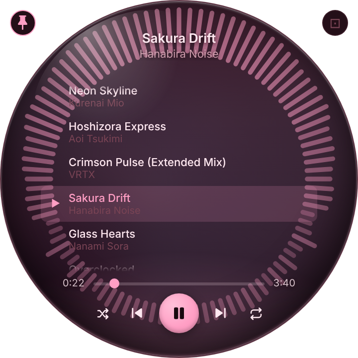
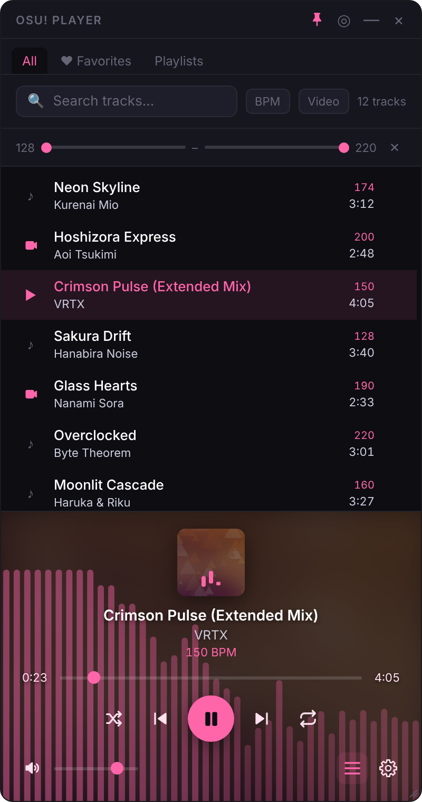

# 🎵 osu! Player

A lightweight, themeable desktop music player for your osu! beatmap collection.

Built with **Tauri 2.0** (Rust) + **React 18** + **TypeScript**.

## Download

**[⬇️ Download the latest release](https://github.com/ShjnAki/osu-music_player/releases/latest)** — Windows installer, no compilation needed.

Grab the `.msi` (or `.exe` NSIS installer), run it, then point the app at your osu! `Songs` folder on first launch.

Want to build it yourself instead? See [Getting Started](#getting-started).

## Features

- 🎵 Plays MP3 and OGG files from your osu! Songs folder
- 📋 Library with search (title / artist) and BPM range filter
- ❤️ Favorites and manual playlists
- 🎨 4 built-in themes (Dark, Glass, Sakura, Minimal)
- 🔀 Shuffle & repeat modes
- 🔊 Volume control
- 🏷️ ID3 tag reading (title, artist) with folder-name fallback
- 🖼️ Album art and beatmap background images
- 🔵 Sphere mode — circular always-on-top window with track list inside
- ⚡ Metadata cache: first scan is slow, subsequent launches load instantly
- 💾 Settings persisted between sessions
- 🪟 Frameless, draggable window

## Screenshots

| Sphere mode | Library |
| --- | --- |
|  |  |

## Prerequisites

- [Node.js 18+](https://nodejs.org/) LTS version
- [Rust (stable)](https://rustup.rs/) or `winget install Rustlang.Rustup` then `rustup default stable`
- [Tauri prerequisites for Windows](https://v2.tauri.app/start/prerequisites/)
  - Microsoft C++ Build Tools `winget install Microsoft.VisualStudio.2022.BuildTools`
  - WebView2 (included in Windows 11, installer available for Windows 10)

## Getting Started

For contributors, or if you'd rather compile from source than use the [prebuilt installer](#download):

```bash
# Install dependencies
npm install

# Development (hot-reload)
npm run tauri dev

# Production build
npm run tauri build
```

## Project Structure

```
osu-player/
├── src/                        # React frontend
│   ├── components/
│   │   ├── Library/            # Track list, search, favorites, playlists, BPM filter
│   │   ├── Player/             # PlayerBar — controls, progress, cover art
│   │   ├── Settings/           # Theme selector, folder picker
│   │   └── SphereView/         # Circular mode layout
│   ├── hooks/
│   │   ├── useAudio.ts         # Howler.js playback engine
│   │   └── useTheme.ts         # CSS variable theming + 4 built-in themes
│   ├── stores/
│   │   └── playerStore.ts      # Zustand global state (persist: folder, volume, theme, favorites, playlists)
│   ├── types/index.ts          # TypeScript interfaces
│   └── styles/globals.css
└── src-tauri/                  # Rust backend
    └── src/lib.rs              # scan_osu_songs, load_tracks_cache, save_tracks_cache, set_sphere_mode
```

## Sphere Mode

Click **◎** in the titlebar to switch to sphere mode: a circular 360×360 window that floats always-on-top. The beatmap background fills the sphere. Click **⊡** to return to normal mode.

## Creating a Custom Theme

Themes are defined in `src/hooks/useTheme.ts` as objects with CSS custom properties. To add a theme, append an entry to the `BUILTIN_THEMES` array:

```ts
{
  id: "my-theme",
  name: "My Theme",
  variables: {
    "--bg-primary": "#0a0a0a",
    "--accent": "#00ff88",
    // ...see ThemeVariables in src/types/index.ts
  }
}
```

## License

MIT — Fork it, mod it, share it! 🎮
